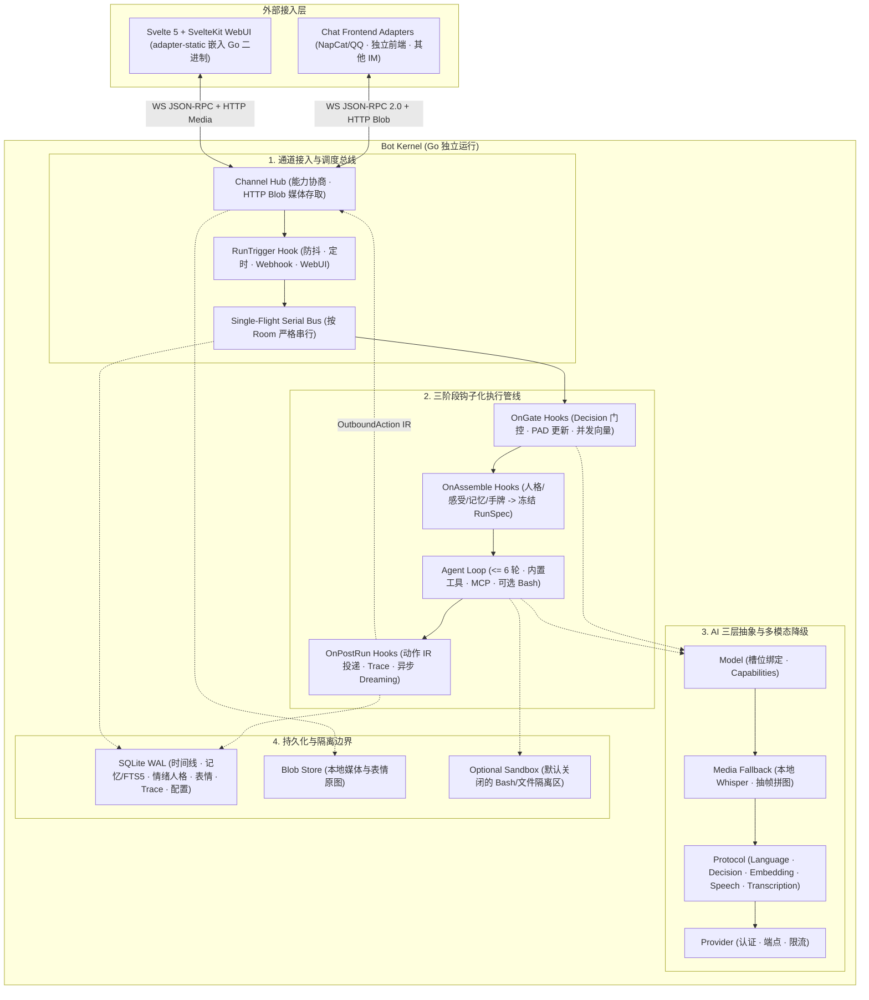

# 系统总体架构与运行时设计方案

> 本文档定义 `omni-bot` 的整体运行时架构、聊天前端抽象、AI 三层抽象、钩子化执行管线、工具/MCP 扩展边界与新 WebUI 工程规范。记忆与人格/情绪子系统的内部算法分别详见 [memory.md](memory.md) 与 [persona-and-emotion.md](persona-and-emotion.md)。

## 1. 设计目标与核心不变量

1. **前端与内核解耦**：QQ/NapCat 仅作为可替换的聊天前端适配器存在，与 Bot Kernel 经由通用的 WebSocket + JSON-RPC 2.0 协议通信；后续可无痛接入独立前端或其他 IM 平台。
2. **不绑死单一模型生态**：采用参考 Vercel AI SDK 的「模型 — 协议 — 供应商」三层抽象，Phase 1–5 聚焦最小闭环协议实现；Google 生态专有能力（File API、`media_resolution`、Decisions API 等）严格封闭在协议层内部，上层透明消费统一契约。
3. **串行一致性与单 Run 冻结**：同一房间/会话维持 Single-Flight 串行总线，杜绝并发抢答与时间线乱序；每次有效触发最多执行 `≤ 6` 轮自研 Agent Loop，**仅在单次 Run 内保证 `RunSpec` 与前缀字节静态以命中缓存，跨 Run 不做脆弱的缓存对齐妥协**。
4. **可插拔的钩子化装配**：外部触发、门控判定、上下文组装与后置异步处理全部通过清晰钩子接入，记忆联想、细粒度情绪、三层人格、表情包手牌等模块以正交组件拼装，避免主控文件膨胀为单体巨石。
5. **热路径零阻塞**：实时消息处理绝不跨越网络/LLM 持锁，也不等待后台归档、Dreaming 巩固或媒体清理。

---

## 2. 系统全景拓扑



---

## 3. 聊天前端抽象与通道协议

### 3.1 传输与媒体边界

* **控制面（WS + JSON-RPC 2.0）**：承载双向实时事件、能力注册与动作下发，线协议携带显式版本号（如 `?proto=1`）。
* **媒体面（HTTP Blob 端点）**：禁止将大体积图片、语音、视频以 Base64 塞入 WS JSON-RPC 帧。前端适配器先将媒体文件上传至 Kernel 的 HTTP Blob 接口换取 `blob_id`（或复用共享卷路径引用），JSON-RPC 载荷中一律只传递轻量 `MediaRef{blob_id, mime_type, size_bytes, duration_ms, meta}`。

### 3.2 平台格式归一化边界（Adapter 职责）

所有聊天软件的私有协议与奇异卡片格式**全部在 Frontend Adapter 层消化转换**，送入 Kernel 的消息必须是平台无关的规范化内容块（`text`、`link`、`image`、`audio`、`video`、`forward_tree`、`mention`、`reply_ref`）：

* 以 **NapCat Adapter** 为例：
  * 负责消费 OneBot v11 事件与 Action（`send_group_msg`、`set_msg_emoji_like`、`group_poke`、`get_msg`、`get_forward_msg`、`get_record`、`get_file`、`get_group_member_info`）；
  * 负责将 QQ 合并转发递归展开为标准文本/媒体树，将 QQ SILK/AMR 语音转为标准音频 Blob；
  * 负责将 QQ 小程序 JSON 卡片、B 站分享卡片等平台特有负载直接解包还原为标准 `link`、元信息文本与原始视频 Blob（含必要切片），Kernel 不感知任何 QQ 协议细节。

### 3.3 能力协商与出站动作 IR

* 前端建连时调用 `channel.register` 上报身份与能力集合（例如 `["reply", "react", "poke", "voice", "sticker", "multi_bubble"]`）；
* 消息信封从第一天起携带 `channel_id` 与 `room_id`（即使当前按单群运行、情绪与人格维持单状态连续演进，后续接入独立调试前端或其他 IM 无需重构表结构与协议）；
* 出站表达延续**轻量文本内联协议**（`[reply:id]`、`|||`、`[meme:#id]`、`[voice:...]`、`[react:id:emoji]`、`[poke:uid]`、`[silent]`）以保持单轮低延迟与自然语感，由 Kernel 统一解析为平台无关的 `[]OutboundAction` 中间表示，下发给 Adapter 按自身声明的能力执行或优雅降级。

---

## 4. AI 能力三层抽象与多模态统一降级

参考 Vercel AI SDK 的分层思想与 REI 的模型契约，将 AI 调用严格拆分为三层，使 Kernel 与 Agent Loop 完全不依赖任何具体厂商 SDK：

### 4.1 三层职责

1. **Provider（供应商层）**：管理连接与凭据——BaseURL、多 API Key 轮询、公共 Header、代理与客户端连接池。配置中仅保存 Host 与凭据，不硬编码具体模型行为。
2. **Protocol（协议层）**：保持 5 类对称的统一接口契约，使 Kernel 与 Agent Loop 不绑定具体厂商；新厂商协议按需以官方 SDK 或轻量标准 HTTP 客户端接入：
   * `LanguageModel`：核心对话、多模态输入、Tool Calling、结构化 `Usage`（显式区分缺省与 0，含 `cached_tokens` / `reasoning_tokens`）与不透明协议续接数据 `NativeContent`。
   * `DecisionModel`：统一多问题并行概率/量表评估契约 `Decide(ctx, DecisionRequest) -> DecisionResult`（支持二元概率与有序量表）。Google 协议走 `/v1beta/decisions`（零输出 Token）；未来接入其他协议时可通过任意 `LanguageModel` 的 Structured Output 实现同一接口作为通用兜底。
   * `EmbeddingModel`：批量文本向量化。
   * `SpeechModel`：文本转语音（TTS），返回音频 Blob。
   * `TranscriptionModel`：音频转文字（STT），服务于多模态降级，默认对接**本地 Whisper**而非云端 ASR。
   * **Google 专有能力隔离红线**：Google File API 的上传、44h TTL 缓存复用、URI 拼装、图片自适应 `media_resolution`（LOW/MEDIUM/HIGH）与 `ThinkingConfig` **必须全部封装在 Google Protocol 内部**，禁止向 Kernel 暴露任何 `files/...` URI 细节。
3. **Model（模型实体层）**：不可变配置绑定 `(Provider, Protocol, ModelID, Capabilities, DefaultParams)`，由运行时各功能槽位（`chat`、`decision`、`summary`、`vision`、`embedding`、`tts`、`stt`）按 ID 引用。

#### Phase 1–5 协议层落地范围（YAGNI 边界）

虽然三层抽象保持多供应商可扩展性，但 Phase 1–5 **仅实现以下具体协议适配器**，不为未启用的厂商编写空壳代码：

| 统一接口 | Phase 1–5 唯一落地实现 | 说明 |
| :--- | :--- | :--- |
| `LanguageModel` | **Gemini Interactions API** | 承担对话、多模态输入与 Tool Calling |
| `DecisionModel` | **Gemini Decisions API**（`/v1beta/decisions`） | 承担门控、并发状态判定与情感刺激评估 |
| `SpeechModel` | **Fish Audio** | 承担语音回复（TTS）合成 |
| `EmbeddingModel` | **OpenAI Embedding**（OpenAI 兼容 `/v1/embeddings`） | 承担记忆与表情包批量文本向量化 |
| `TranscriptionModel` | **本地 Whisper** | 承担不支持原生音频/视频时的离线 STT 降级，不依赖云端 ASR |

### 4.2 统一多模态降级中间件（Media Fallback Middleware）

每个 `LanguageModel` 显式声明自身能力 `Capabilities{Vision, AudioIn, VideoIn}`。在进入具体 Protocol 适配器之前，由统一的 Media Fallback 中间件按目标模型能力无损适配媒体输入：

| 输入媒体类型 | 目标模型原生支持 | 目标模型不支持时的统一降级路径 |
| :--- | :--- | :--- |
| **图片 (`image`)** | 原样透传 `MediaRef` 给协议层 | 降级为已有视觉标签（如表情包描述）或占位文本 |
| **音频 (`audio`)** | 原样透传 `MediaRef`（Google 协议内部透明走 File API） | 自动调用 `TranscriptionModel`（**本地 Whisper**）转写为带时长与来源标记的文本 |
| **视频 (`video`)** | 原样透传 `MediaRef`（Google 协议内部透明走 File API） | 使用 `ffmpeg` 均匀抽帧并拼为网格图（当目标支持 `Vision` 时附入）+ 提取音轨走 `TranscriptionModel`（**本地 Whisper**）转写字幕（有声时）；均不支持时退化为元信息/摘要文本 |

降级产物按 `blob_id` 缓存，避免同一次 Run 多步调用或后续轮次重复转写/抽帧。

---

## 5. Kernel 运行时总线、钩子体系与 Agent Loop

### 5.1 统一外部触发钩子与串行总线

* **统一触发口（`RunTrigger`）**：无论是新群消息防抖窗口到期、主动定时冒泡、外部 Webhook 推送，还是 WebUI 手动调试触发，全部封装为统一 `TriggerEvent{Source, RoomID, BypassGate, Payload}` 投递至总控队列。
* **Single-Flight 串行总线**：每个 `room_id` 严格保证同一时刻至多有一个活跃 Checkpoint / Agent Run；运行期间新抵达的消息持续写入 SQLite 时间线并在本轮结束后自动微批合并进入下一轮，避免时间线竞争与重复回复。

### 5.2 三阶段钩子管线（与记忆、人格、情绪层集成）

将原有单体处理逻辑拆解为三组清晰、低耦合的 Go 钩子接口：

1. **`OnGate`（门控与状态演进）**
   * 组装轻量近期窗口 + 当前第一人称 `<inner_feeling>`，调用 `DecisionModel` 在单次请求内并行输出：是否接话概率、令咒/漂移自检等扩展门控信号，以及本轮新消息对 `(P, A, D)` 三维情绪的瞬时刺激（详见 [persona-and-emotion.md](persona-and-emotion.md)）。
   * 情绪状态机依据气质动力参数更新连续 `(P, A, D)` 向量（即使未放行发言，旁观群聊亦平滑演进）。**严禁在此阶段根据情绪数值硬编码篡改接话阈值或后续气泡数量。**
   * 如记忆被动联想启用并发向量种子（由 [memory.md](memory.md) 阶段 0 评测裁决），query embedding 计算与 `DecisionModel` 请求并发发出，消除额外端到端延迟。

2. **`OnAssemble`（有序 `ContextContributor` 与冻结 `RunSpec`）**
   * Gate 放行后，各 `ContextContributor` 按固定优先级向 `ContextDraft` 注入片段，随即**冻结为只读 `RunSpec`** 交由 Agent Loop 执行。
   * 装配顺序与视角严格遵守 [persona-and-emotion.md](persona-and-emotion.md#3-提示词人称与分层表现规范) 与 [memory.md](memory.md)：
     * **System Prompt（低频静态区）**：
       1. 系统运行协议与内联动作说明（中性 / 第二人称，与角色心智物理隔离）；
       2. 冻结的《自我观念与信念》（真第一人称“我”）；
       3. 慢变《性格》原子条目清单（真第一人称“我”，8~12 条硬上限）。
     * **Dynamic Context（单次 Run 内冻结不变）**：
       1. 滚动剧情摘要 + 预算裁剪后的近期逐字时间线（Bot 自身历史回复以自身群昵称或 `[我(昵称)]` 呈现，避免人称割裂）；
       2. 当下细粒度情绪体验 `<inner_feeling>`（第一人称内在感受，原点中性区不注入）；
       3. 被动联想浮现记忆 `<associated_memories>`（由记忆 Contributor 产出，统一带 `t_event` 时间前缀与窗口去重）；
       4. 表情包手牌架 `<available_memes>` 及令咒 / Drift 纠偏等扩展区块。

3. **`OnPostRun`（投递、审计与后台异步）**
   * 解析模型最终输出为 `[]OutboundAction` IR 并下发给 Frontend Adapter，实际发出的文本/媒体回写时间线；
   * 将完整 **Run Trace**（触发源、Gate 分数与 PAD 轨迹、被动联想命中线索与评分、每步 LLM Token/缓存/思考耗时、工具与 MCP 调用明细、投递结果）结构化写入 SQLite；
   * 异步通知后台维护协程（滚动摘要、表情收录、浅层记忆蒸馏、有效召回引用反馈、周期性 Dreaming 巩固与人格慢演化），零阻塞主链路。

### 5.3 自研可靠 Agent Loop

* **步数硬上限**：单次有效消息触发最多执行 `≤ 6` 轮模型/工具交互（默认可配，最高 6 轮），防止死循环与延迟失控。
* **缓存策略**：`RunSpec` 在进入 Loop 时冻结，Run 内多步追加工具调用与结果时保持前缀字节完全一致，确保**单次 Run 内前缀缓存稳定命中**；跨 Run 不强求前缀对齐，换取记忆/情绪注入的完全自由度。
* **可靠性纪律**：透传 `context.Context` 超时与取消；统一错误分类（鉴权/参数错误不重试，瞬时网络/限流由 Loop 显式受控重试 1 次，底层 SDK 禁用叠加重试）；非法工具参数或工具执行异常统一回传明确错误文本给模型而非崩溃中断 Run。

---

## 6. 工具体系、Bash 能力与 MCP 扩展

### 6.1 核心内置工具

* `memory_recall`：主动回忆工具（对接 [memory.md](memory.md) 的 FTS5 + 向量 + 时间范围 + 冷归档检索）；
* `web_search` / `web_fetch`：联网搜索与网页正文提取（Go 侧可结合 `go-trafilatura` 与搜索 API）；
* `manage_meme`：表情包收录、印象修正与拉黑删除。

### 6.2 Bash 与文件工具集（默认关闭，支持一键启用）

* **实现复用**：参考 `pi` 与 REI 的极简工具集哲学（`bash`、`read`、`write`、`edit`、`find`、`grep`），直接借鉴 REI 已踩坑验证的输出头尾截断（行数/字节预算 + 完整日志落盘路径）、超时控制与子进程组强杀机制，不重复造轮子；不引入 REI 跨网远程 Env 的分布式重投递台账。
* **默认关闭与安全隔离**：
  * 该工具组在运行时配置中**默认关闭**（不向模型注册 Schema），支持通过 WebUI 配置一键启用；
  * 启用后，命令执行与文件访问**必须约束在独立的受限工作区/隔离环境**中，子进程环境剔除 Kernel 所有 API Key 与敏感环境变量，严禁访问主 SQLite 数据库与配置文件；任何群聊交互机制（如令咒）均无权绕过此边界。

### 6.3 MCP 扩展（官方最新 Go SDK）

* 直接基于官方 `github.com/modelcontextprotocol/go-sdk` 接入外部 MCP Server，不手写协议栈；
* 支持 **Streamable HTTP** 与本机 **stdio** 两种传输方式，优先支持新版规范特性：Structured Tool Output（保留 `structuredContent`）、`notifications/tools/list_changed` 动态工具列表热刷新与长耗时工具进度通知；
* 工具命名统一带服务器前缀防冲突；群聊无人值守场景默认关闭高危的 `Sampling` 与 `Elicitation` 能力；配置变更后在后台热重建连接池，已在进行中的 Run 沿用冻结快照不受影响。

---

## 7. 存储、配置管理与旧资产迁移

### 7.1 存储布局（SQLite WAL + 本地 Blob）

所有结构化数据统一落盘于单一 SQLite 数据库（开启 WAL 模式与 `busy_timeout`，严禁持内存锁跨越网络/LLM 调用）：
* 群聊追加式时间线与滚动摘要；
* 记忆层表（`memories`、`memory_entities`、`memory_assoc`、`FTS5` 与向量索引，见 [memory.md](memory.md)）；
* 情绪状态轨迹、气质动力参数、冻结自我观念与慢变性格条目版本快照（见 [persona-and-emotion.md](persona-and-emotion.md)）；
* 表情包元数据、pHash 与向量；
* Run Trace 可观测记录与运行时配置表。

图片、语音、视频与表情原图/缩略图统一落在本地 `blobs/` 与 `memes/` 目录，SQLite 仅保存哈希、元信息与相对路径。

### 7.2 配置所有权与热更新

* **静态启动层（极简 CLI Flag / 启动配置）**：仅包含监听地址、数据根目录（SQLite + Blob）、可选 Bash 沙箱工作区路径与日志级别；
* **动态配置层（SQLite + WebUI 实时热生效）**：Provider 列表、Model 槽位绑定、MCP Server 定义、人格冻结文本、功能开关（记忆、情绪、表情收录、Bash 一键开关等）。所有 API Key 与凭据遵循 **write-only** 原则，查询接口与审计日志一律脱敏返回。

### 7.3 旧版资产迁移 CLI 与安全演练边界

提供独立、可幂等重跑的命令行迁移工具（如 `omni-bot migrate-legacy --from <legacy_dir> --to <target_dir>`），负责将生产环境旧版 `alpha` 积累的 `memes.db`（表情原图、缩略图、视觉打标描述/情绪/场景、pHash、使用频次）以及历史时间线、人格/记忆资产无损导入新库。

* **只读快照开发与验证**：迁移逻辑的开发、回归测试与数据一致性校验**必须基于本地只读快照目录 `data/legacy_snapshot/`**（已加入 `.gitignore`，严禁入库）完成，验证目标包括记录数对账、媒体哈希完整性、重复执行幂等性与查询可用性；
* **禁止自动切换生产**：迁移工具与开发流程**绝不自动修改或切流生产 `alpha` 实例及数据目录**；所有生产割接必须由用户在审阅迁移报告与回归验收结果后显式手动执行。

---

## 8. 新 WebUI 架构与视觉工程规范

### 8.1 技术栈与部署形态

* **技术栈**：`Svelte 5 (Runes & Snippets) + SvelteKit + TypeScript (strict) + Tailwind CSS v4 + shadcn-svelte`。
* **部署形态**：SvelteKit 采用 `@sveltejs/adapter-static`（SPA 模式）构建静态产物，由 Go 通过 `embed.FS` 直接内嵌进单个可执行文件，生产环境零 Node.js 依赖；开发期由 Vite Proxy 转发 WS 与 `/media` 请求至本地 Kernel。
* **通信边界**：WebUI 复用 Kernel 的 WS JSON-RPC 通道订阅实时 Run Trace、情绪 PAD 实时坐标波形、消息时间线与配置热写；表情包缩略图/原图等二进制资源通过标准 HTTP GET 端点加载。

### 8.2 视觉气质与硬性验收规范

* **风格定位**：面向娱乐向拟人 Bot 的**活泼清新**视觉语言——选用明快柔和、有呼吸感的色彩体系与清爽点缀色，摒弃冰冷黑白后台风；美术资产可按需结合图标库、手绘 SVG 与生图模型素材。
* **严禁「边框套边框」的 AI 模板味**：`shadcn-svelte` 仅借用其底层无障碍交互原语（`bits-ui`），在 Tailwind v4 `@theme` 中深度覆写默认样式，剥离层层嵌套的 `1px` 细线边框，改用 **色差/明度阶梯（Tonal Surface）+ 清晰间距 + 轻柔投影** 表达信息层级。
* **文案极度克制**：少用解释性副标题与大段说明文字，依靠排版层级、直观标签、状态色块与布局逻辑让界面自解释。
* **丰富的微动效**：善用 Svelte 5 原生 `Spring` 与平滑过渡，让情绪状态变化、Run 流水线步进、表情库筛选与弹窗交互轻盈灵动。
* **视觉截图验收门禁**：核心页面开发完成后必须真实运行并截图检视（覆盖桌面宽屏与窄屏），逐项确认组件排版整齐，**零挤压换行、零错位重叠、色彩对比度清晰**。

---

## 9. 统一工程契约与 CI 门禁

为确保多模块演进与并行协作期间的风格、可观测性与质量一致，所有子系统强制遵循以下共享契约：

### 9.1 跨模块一致性约定

* **TDD 与最小 Mock**：核心业务逻辑先写失败测试再实现；优先使用真实临时目录（`t.TempDir()`）、真实本地 SQLite 与 `net/http/httptest` 本地桩，避免脆弱的过度 Mock 与无信号样板测试。
* **错误处理**：统一使用 `fmt.Errorf("...: %w", err)` 保留因果链，使用 `errors.Is` / `errors.As` 判定可重试性（如鉴权/参数错误 vs 瞬时网络/限流），严禁静默吞错。
* **结构化日志**：全仓统一使用标准库 `log/slog`，按 `room_id`、`run_id`、`component` 等稳定字段记录关键事件；日志与错误消息严禁输出 API Key、Token 或原始凭据。
* **配置与环境隔离**：生产运行配置遵循 §7.2（启动参数 + SQLite 热配置）；开发期离线评测与集成测试通过共享包加载本地 `.env.local`（不覆盖进程已显式设置的环境变量），`.env.local` 与 `data/` 严格保持在 `.gitignore` 内。
* **纯 Go 构建友好**：默认不依赖本地 CGO/gcc 即可完成编译与常规单测，避免 Windows/Linux 跨平台环境碎片化。

### 9.2 统一 CI 门禁

本地与 GitHub Actions 执行同一套门禁脚本（`scripts/ci.ps1` / `scripts/ci.sh` 与 `.github/workflows/ci.yml`）：

1. **格式检查**：`gofmt -l` 必须零输出；
2. **静态分析**：`go vet ./...` 零告警；
3. **测试与竞态检测**：CI（CGO 可用环境）强制执行 `go test -race ./...`；本地无 C 编译器的 Windows 环境自动降级执行 `go test ./...` 并输出明确提示；
4. **目录索引自动校验**：跨平台 Go 校验器检查每个被跟踪目录（排除 `.git`、`.github`、`data`、`node_modules`）均包含 `README.md`，且其中逐项索引了全部现有文件与子目录、无残留失效条目；
5. **前端构建门禁（条件触发）**：当 `web/` 目录落地后，自动执行 `pnpm check` 与 `pnpm build`。

---

## 10. 推荐仓库目录蓝图（按需渐进创建）

> 以下仅为后续编码阶段的模块边界规划，遵循 `AGENTS.md` 目录索引规范，不在落地代码前预建空目录。

```text
omni-bot/
├── cmd/
│   ├── kernel/              # Bot Kernel 主入口（内嵌 WebUI + CLI 迁移子命令）
│   └── napcat-adapter/      # NapCat OneBot v11 <-> Channel JSON-RPC 适配器
├── internal/
│   ├── protocol/            # Channel 与 WebUI 共享的 WS JSON-RPC 线协议类型
│   ├── channel/             # Channel Hub、能力协商与 HTTP Blob 媒体存取
│   ├── ai/                  # Model / Protocol / Provider 三层抽象 + Media Fallback
│   ├── kernel/              # Single-Flight 总线、RunTrigger、三阶段钩子与 Agent Loop
│   ├── memory/              # 联想记忆层、时序合并、Dreaming 与离线评测器
│   ├── persona/             # 三层人格演化、细粒度 PAD 情绪引擎与词表
│   ├── tools/               # 内置工具、默认关闭的 Bash/文件工具集与官方 MCP Client
│   ├── meme/                # 表情包库、pHash 去重、视觉打标与手牌检索
│   ├── store/               # SQLite WAL 持久化、配置热管与旧资产迁移器
│   └── webui/               # embed.FS 静态产物挂载
├── web/                     # Svelte 5 + SvelteKit + Tailwind v4 + shadcn-svelte 前端
└── docs/design/             # 总体架构、记忆、人格与情绪设计文档
```
